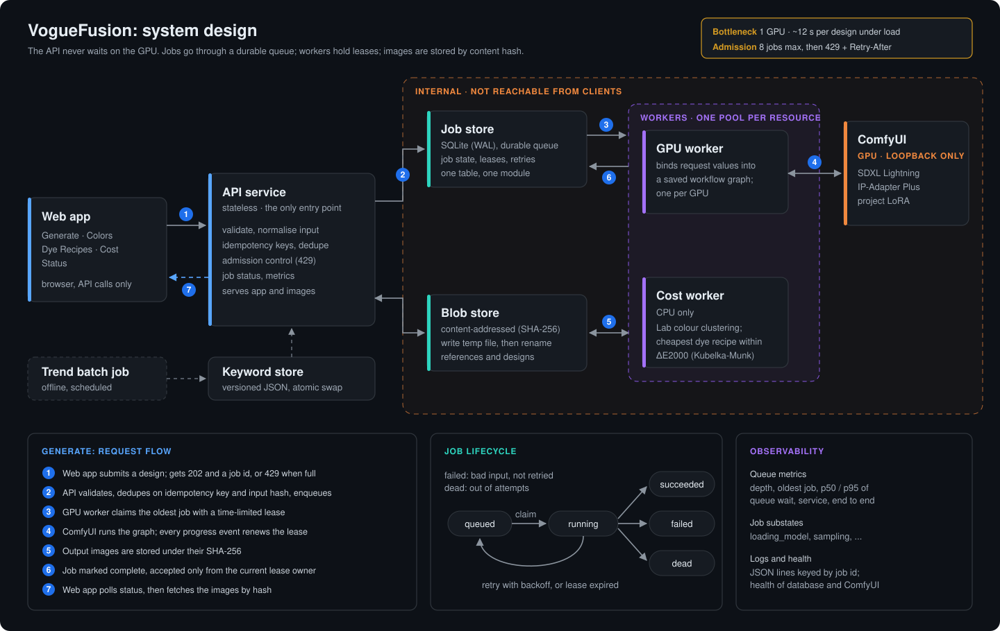
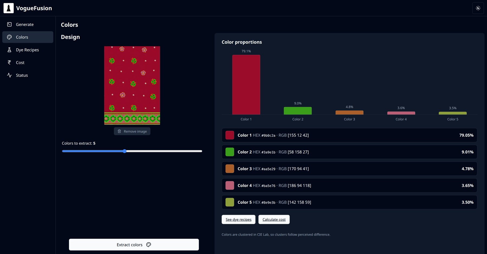
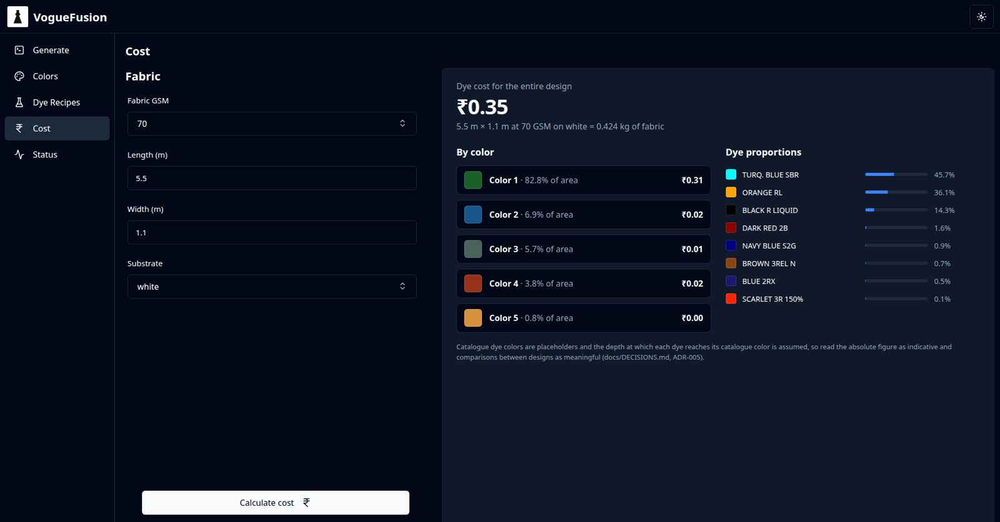

# VogueFusion

VogueFusion generates saree and kurti print designs from reference prints
and estimates the dye cost of printing them.

A designer gives up to four reference prints and a prompt. SDXL with
IP-Adapter, plus a LoRA fine-tuned on 82 saree prints, generates new designs
in that style. Any design can then be costed: its dominant colours are
extracted, each colour gets the cheapest dye recipe that matches it within a
perceptual tolerance, and the dye cost is totalled for a piece of fabric.


## What it does

- **Generate.** ComfyUI runs DreamShaper XL Lightning with IP-Adapter Plus
  (4 reference slots). Workflow `v2` adds the project's LoRA (rank 32,
  alpha 16). Every result records its seed, workflow hash and model hashes.
- **Colors and dye recipes.** Pixels are clustered in CIE Lab. For each
  colour, the solver finds the cheapest mix of up to 3 of the catalogue's
  20 dyes whose Kubelka-Munk prediction is within CIEDE2000 2.0 of it, or
  reports that no mix is.
- **Cost.** Dye mass per colour from its recipe, its share of the design
  and the fabric weight, priced from the supplier's list (INR per kg).
- **Status.** Queue depth and latency percentiles, live.

## System design



- **Asynchronous jobs.** `POST /v1/designs` returns 202 and a job id; the
  client polls. A generation takes 10 to 40 s and fills 5.65 of 6 GB of
  VRAM, so it cannot be served inside an HTTP request or run two at a time.
- **Durable queue with leases.** Jobs live in SQLite (WAL). A worker
  claims a job with a lease and renews it on every progress event. If the
  worker dies, the lease lapses and the job is retried; a worker that lost
  its lease cannot overwrite the new owner's result.
- **Backpressure.** Each job kind has a depth limit. Past it, submit
  returns 429 with `Retry-After = ceil(depth × p50 service time / workers)`.
- **No duplicate GPU work.** `Idempotency-Key` returns the original job on
  a retry, and a request identical to a finished one is served from its
  stored result.
- **Content-addressed storage.** Images are stored under their SHA-256,
  written to a temp file and renamed, so a crash never leaves a partial
  file at a valid address.
- **One worker pool per resource.** The GPU worker drives ComfyUI; the cost
  worker runs on CPU. A slow generation never delays a quote.

[`docs/ARCHITECTURE.md`](docs/ARCHITECTURE.md) has the request walkthrough,
failure modes with the test for each, measured capacity, and what changes
at 10x and 100x load. [`docs/DECISIONS.md`](docs/DECISIONS.md) has the
decision records, including the alternatives rejected.

## Measured performance

RTX 3060 Laptop GPU (6 GB), 22 GB RAM.

| | Time |
|---|---|
| One design, models loaded (v1 / v2 with LoRA) | 10.2 s / 12.3 s |
| Same, under sustained load (the laptop GPU throttles) | about 12.5 s |
| First design after ComfyUI starts | 40.8 s |
| Three designs in one batch (v1) | 26.9 s |
| Dye quote, 5 colours | about 3 s |
| Queue wait p95, load test at 82% utilisation | 12.7 s |

Methods and raw results: [`docs/ARCHITECTURE.md`](docs/ARCHITECTURE.md#6-capacity).

## Quick start

Needs Linux, an NVIDIA GPU with 6 GB or more, conda, and about 11 GB of disk
for models.

```bash
# Python environment for this repo
conda create -n voguefusion python=3.11 && conda activate voguefusion
pip install -r requirements.txt

# ComfyUI, outside the repo, pinned
conda create -n comfy python=3.12
conda run -n comfy pip install torch torchvision torchaudio --index-url https://download.pytorch.org/whl/cu128
git clone https://github.com/comfyanonymous/ComfyUI.git ~/ComfyUI && git -C ~/ComfyUI checkout 989d93d0
conda run -n comfy pip install -r ~/ComfyUI/requirements.txt
git clone https://github.com/cubiq/ComfyUI_IPAdapter_plus.git ~/ComfyUI/custom_nodes/ComfyUI_IPAdapter_plus
git -C ~/ComfyUI/custom_nodes/ComfyUI_IPAdapter_plus checkout a0f451a

# Models (about 10 GB), each checked against the SHA-256 in comfyui/models.json
comfyui/download_models.sh

# Prompt keyword store
PYTHONPATH=src python scripts/build_trends.py
```

Run:

```bash
scripts/vf.sh start     # ComfyUI, API, GPU worker, cost worker
scripts/vf.sh status
scripts/vf.sh stop
```

Then open http://127.0.0.1:8000. Runtime data (job database, images, logs,
measurements) goes to `$VOGUEFUSION_DATA`, default `~/voguefusion-data`.

Verify everything:

```bash
scripts/verify.sh
```

This runs lint, the test suite (no GPU needed; ComfyUI is faked), a docs
check and, when the stack is running, a replay of a committed design
through ComfyUI, an end-to-end run through the API, and the whole web app
flow in headless Chrome.

## The app

| Colors | Dye Recipes | Cost |
|---|---|---|
|  |  |  |

The look follows the original 2024 Workbench.

## API

| Method | Path | |
|---|---|---|
| POST | `/v1/references` | Upload an image (PNG, JPEG, WebP); returns its SHA-256 |
| POST | `/v1/designs` | Submit a generation: 202 + `Location`, 429 when the queue is full |
| GET | `/v1/designs/{id}` | State, substate (`loading_model`, `sampling`, ...), result |
| POST | `/v1/costs` | Submit a dye quote for an image |
| GET | `/v1/costs/{id}` | The quote |
| GET | `/v1/artifacts/{sha256}` | Image bytes, cacheable forever |
| GET | `/v1/workflows`, `/v1/costing` | Workflow defaults; dye catalogue and fabric defaults |
| GET | `/v1/suggestions`, `/v1/metrics`, `/healthz` | Prompt keywords, queue metrics, health |

## Repository layout

```
src/voguefusion/   API, job store, blob store, workers, ComfyUI client, workflow binding, trends
src/costing/       colour science, colour extraction, dye solver, quote
ui/web/            the web app (HTML, CSS, JavaScript; no build step)
comfyui/           workflow graphs, model manifest, downloader
configs/           every tunable value
scripts/           vf.sh, verify.sh, e2e, ui_check, replay, measure, build_trends, recover_workflows
tests/             colour science, costing, services (with a fake ComfyUI)
docs/              architecture, decision records, system design diagram
dataset/           82 saree prints with captions (LoRA training set), 9 committed outputs
trend_and_cost_prediction/   the original 2024 app, kept for reference; its data/ holds the
                             dye catalogue and the supplier price list
```

## How the generation pipeline was recovered

The original ComfyUI workflow was not in the repository. Every PNG ComfyUI
writes embeds the graph and seed that produced it, so
`scripts/recover_workflows.py` extracts the workflow from the committed
outputs, and `scripts/replay.py` re-runs a committed output's exact graph
and seed to check the rebuilt pipeline. The replay is the same design with
slightly shifted motifs: mean per-pixel ΔE2000 of 13.8 to 14.7 against the
original, versus 19.6 or more against the other committed outputs.

## Known limitations

- **Absolute dye costs are not reliable.** The catalogue's dye colours are
  placeholders, and the depth at which a dye reaches its catalogue colour is
  assumed (20 g per kg of fabric). A saree quotes at about INR 1 of dye.
  Comparisons between designs are more meaningful than any single figure.
  Fixing this needs dye swatches measured at a known depth.
- **Mixing is a 3-channel approximation** of Kubelka-Munk, not spectral, so
  it cannot predict metamerism.
- **There is no trend signal.** The 2024 Pinterest scrape was never
  analysed and its images are gone. The keyword store is built from the
  LoRA training captions, which have no dates.
- **One machine, one GPU, no authentication.** The design scales out
  (Postgres queue, object store, one ComfyUI per GPU); only the
  single-machine version is built. Everything binds to 127.0.0.1.

## Acknowledgements

SDXL (Podell et al.), DreamShaper XL (Lykon), IP-Adapter (h94),
ComfyUI and ComfyUI_IPAdapter_plus, CIEDE2000 test data from Sharma, Wu and
Dalal (2005).
