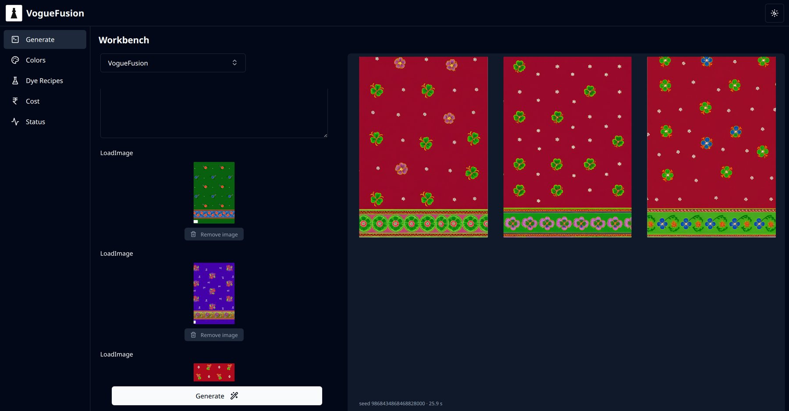
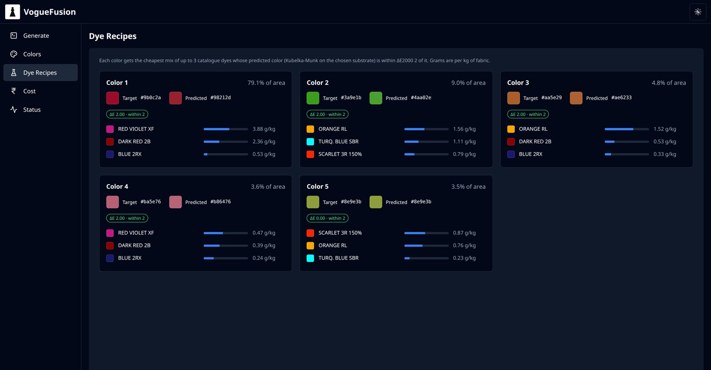
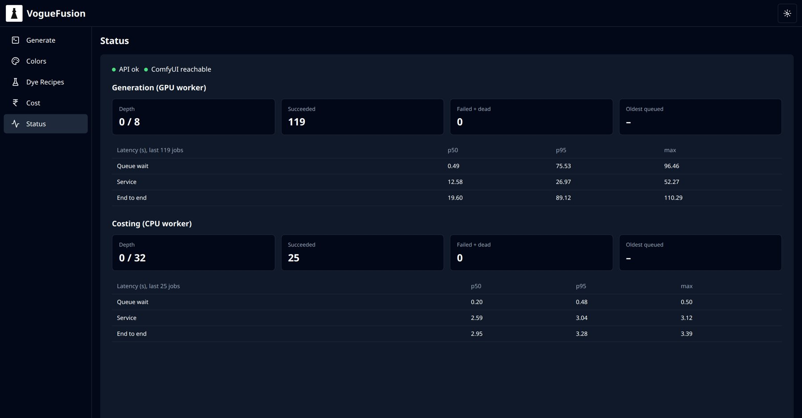

# VogueFusion

**Generate textile print designs from reference prints, then quote the dye cost of printing them.**

A designer gives up to four reference prints and a prompt. SDXL with
IP-Adapter, plus a LoRA fine-tuned on 82 saree prints, generates new designs
in that style. Any design can then be costed: its dominant colours are
extracted, each colour gets the cheapest dye recipe that matches it within a
perceptual tolerance, and the dye cost is totalled for a piece of fabric.



Behind the UI is a small production-shaped service: asynchronous jobs on a
durable queue, leased workers that survive crashes, backpressure, idempotent
submits, content-addressed storage, and a deterministic costing engine. Every
claim below links to the test or measurement that backs it.

## Demo

Recorded on the first version of the app (December 2024).

https://github.com/user-attachments/assets/10fd9ecd-1782-43ba-8745-251c94a3c379

## At a glance

| | |
|---|---|
| **Generation** | ComfyUI · DreamShaper XL Lightning (SDXL) · IP-Adapter Plus, 4 reference slots · project LoRA (rank 32, alpha 16) |
| **Service** | Python 3.11 · FastAPI · SQLite (WAL) job queue · content-addressed blob store · GPU and CPU worker pools |
| **Costing** | CIE Lab clustering · CIEDE2000 tolerance · Kubelka-Munk mixing · exhaustive search with SLSQP refinement |
| **Frontend** | One static web app (HTML, CSS, JavaScript), no build step, served by the API |
| **Measured on** | RTX 3060 Laptop GPU, 6 GB; about 12 s per design under sustained load, 3 s per quote |
| **Verification** | 141 tests with a fake ComfyUI (no GPU needed), plus replay, end-to-end and browser checks in one script |

## System design


A generation takes 10 to 40 s and uses 5.65 of the GPU's 6 GB, so it can
neither run inside an HTTP request nor run two at a time. Everything follows
from that.

| Decision | Why | Evidence |
|---|---|---|
| Asynchronous jobs: submit returns 202, the client polls | Requests would otherwise be held for up to 40 s and break on any disconnect | [ADR-002](docs/DECISIONS.md#adr-002-asynchronous-jobs-with-a-durable-queue-in-front-of-the-gpu) |
| Durable queue in SQLite (WAL) with leases | Durable, atomic claims across processes, inspectable, no extra service to run on one machine; all queue SQL is in one module, so moving to Postgres is contained | [ADR-011](docs/DECISIONS.md#adr-011-sqlite-in-wal-mode-as-the-queue-and-job-store) |
| Fencing on every worker write | A worker that lost its lease cannot overwrite the job's new owner | `test_stale_worker_cannot_complete_after_losing_its_lease` |
| Admission control: 429 with `Retry-After` | Bounded backlog; the client is told when to come back, computed from measured service time | `test_backpressure_returns_429_with_retry_after` |
| Idempotency keys and input-hash coalescing | Client retries and identical requests never cost GPU time twice | `test_cached_result_does_not_touch_the_gpu` |
| Content-addressed images, write then rename | Free deduplication, cache-forever URLs, no partial files after a crash | [ADR-003](docs/DECISIONS.md#adr-003-content-addressed-blob-storage) |
| One worker pool per resource | A slow generation never delays a 3 s quote | `test_cost_is_not_blocked_by_a_stuck_gpu_job` |
| ComfyUI on loopback only; request values written into a saved graph | Clients never reach the GPU process and cannot change the graph | `test_hostile_prompt_text_cannot_change_graph_structure` |

The full design, including the request walkthrough, capacity model and the
plan for 10x and 100x load, is in [`docs/ARCHITECTURE.md`](docs/ARCHITECTURE.md).
Each decision and its rejected alternatives are in
[`docs/DECISIONS.md`](docs/DECISIONS.md).

## Failure handling

| Failure | What happens | Test |
|---|---|---|
| Worker process killed mid-job | Its lease lapses; the job is retried and finishes as attempt 2 | `test_worker_killed_mid_job_recovers` (real `SIGKILL`) |
| Two workers race for one job | Exactly one wins the claim | `test_concurrent_claims_never_hand_out_a_job_twice` |
| ComfyUI down | Retried with backoff, then `dead` with the last error kept | `test_comfy_unreachable_retries_then_dead` |
| ComfyUI hangs | Times out after a silent period and is retried | `test_hung_comfy_times_out_and_retries` |
| Out of GPU memory | Retried; `dead` if it keeps failing | `test_execution_error_is_retried` |
| Graph rejected by ComfyUI | `failed` at once, no retry | `test_rejected_graph_fails_without_retry` |
| Client retries a submit | Same job returned; same key with a different body is 409 | `test_design_submit_dedupe_and_idempotency` |
| Crash while writing an image | Nothing is left at the final address | `test_interrupted_blob_write_leaves_nothing_at_final_address` |

Tests live in [`tests/services/`](tests/services/) and run against a fake
ComfyUI that speaks the same HTTP and websocket protocol.

## Performance

Measured on an RTX 3060 Laptop GPU (6 GB) with 22 GB RAM.

| | |
|---|---|
| One design, models loaded (v1 / v2 with LoRA) | 10.2 s / 12.3 s |
| One design under sustained load | about 12.5 s, because the laptop GPU throttles (clock −19%, measured) |
| First design after ComfyUI starts | 40.8 s |
| Three designs in one batch | 26.9 s |
| Dye quote, 5 colours | about 3 s |
| Queue wait p95 at 82% utilisation (Poisson load test) | 12.7 s |
| Peak GPU memory / ComfyUI RAM | 5.65 of 6.14 GB / 12.3 GB |

The load test, the throttling investigation and the queueing model they are
compared against are in [`docs/ARCHITECTURE.md`](docs/ARCHITECTURE.md#6-capacity).

## The app

One app with five views, in the style of the original 2024 Workbench.

| Colors | Dye Recipes |
|---|---|
|  |  |
| **Cost** | **Status** |
|  |  |

## How the costing works

1. **Colours.** Pixels are clustered with k-means in CIE Lab, so clusters
   follow perceived difference rather than raw RGB distance.
2. **Mixing.** A dye mixture's colour is predicted with single-constant
   Kubelka-Munk on the chosen substrate. Dyes subtract light, so averaging
   RGB, as the first version did, predicts the wrong colours.
3. **Recipe.** For each colour: the cheapest mix of up to 3 of the 20
   catalogue dyes whose predicted colour is within CIEDE2000 2.0. Accuracy
   is a constraint, not a weight traded against cost. Unreachable colours
   are reported as such.
4. **Search.** All 1,350 dye sets are screened in closed form (K/S is
   linear in concentration), then the best few are refined with SLSQP. The
   first version's genetic algorithm quoted the same colour at 3x to 42x
   different prices across random seeds; this is deterministic and is
   checked against a brute-force grid
   (`test_cost_matches_brute_force_grid_over_one_and_two_dye_recipes`).
5. **Cost.** Dye grams per kg of fabric, times each colour's share of the
   design and the fabric weight, priced from the supplier's list.

## Recovering the generation pipeline

The ComfyUI workflow from 2024 was not in the repository. ComfyUI embeds
the graph and seed in every PNG it writes, so
[`scripts/recover_workflows.py`](scripts/recover_workflows.py) extracts the
workflow from the committed outputs, and
[`scripts/replay.py`](scripts/replay.py) re-runs a committed output's exact
graph and seed. The replay is the same design with slightly shifted motifs:
mean per-pixel ΔE2000 13.8 to 14.7 against the original, versus 19.6 or
more against the other outputs, and identical on every rerun.

## Running it

Needs Linux, an NVIDIA GPU with 6 GB or more, conda, and about 11 GB of disk
for models.

```bash
# This repo
conda create -n voguefusion python=3.11 && conda activate voguefusion
pip install -r requirements.txt

# ComfyUI, outside the repo, pinned
conda create -n comfy python=3.12
conda run -n comfy pip install torch torchvision torchaudio --index-url https://download.pytorch.org/whl/cu128
git clone https://github.com/comfyanonymous/ComfyUI.git ~/ComfyUI && git -C ~/ComfyUI checkout 989d93d0
conda run -n comfy pip install -r ~/ComfyUI/requirements.txt
git clone https://github.com/cubiq/ComfyUI_IPAdapter_plus.git ~/ComfyUI/custom_nodes/ComfyUI_IPAdapter_plus
git -C ~/ComfyUI/custom_nodes/ComfyUI_IPAdapter_plus checkout a0f451a

# Models (about 10 GB), each checked against its SHA-256 in comfyui/models.json
comfyui/download_models.sh

# Prompt keyword store
PYTHONPATH=src python scripts/build_trends.py

# Start ComfyUI, the API and both workers, then open http://127.0.0.1:8000
scripts/vf.sh start
```

`scripts/vf.sh status` and `scripts/vf.sh stop` manage the processes.
Runtime data (job database, images, logs, measurements) goes to
`$VOGUEFUSION_DATA`, default `~/voguefusion-data`.

To check everything:

```bash
scripts/verify.sh
```

This runs lint, the test suite, a docs check and, when the stack is running,
a replay through ComfyUI, an end-to-end run through the API, and the whole
app flow in headless Chrome.

## API

| Method | Path | |
|---|---|---|
| POST | `/v1/references` | Upload an image (PNG, JPEG, WebP); returns its SHA-256 |
| POST | `/v1/designs` | Submit a generation: 202 + `Location`, or 429 when the queue is full |
| GET | `/v1/designs/{id}` | State, substate (`loading_model`, `sampling`, ...), result |
| POST | `/v1/costs` | Submit a dye quote for an image |
| GET | `/v1/costs/{id}` | The quote |
| GET | `/v1/artifacts/{sha256}` | Image bytes, cacheable forever |
| GET | `/v1/workflows`, `/v1/costing` | Workflow defaults; dye catalogue and fabric defaults |
| GET | `/v1/suggestions`, `/v1/metrics`, `/healthz` | Prompt keywords, queue metrics, health |

## Repository layout

```
src/voguefusion/   API, job store, blob store, workers, ComfyUI client, workflow binding, trends
src/costing/       colour science, colour extraction, dye solver, quote
ui/web/            the web app
comfyui/           workflow graphs, model manifest, downloader
configs/           every tunable value, in one file
scripts/           vf.sh, verify.sh, e2e, ui_check, replay, measure, build_trends, recover_workflows
tests/             colour science, costing, services (with a fake ComfyUI)
docs/              architecture, decision records, system design diagram
dataset/           82 saree prints with captions (LoRA training set), 9 committed outputs
trend_and_cost_prediction/   the 2024 app, kept for reference; data/ holds the dye catalogue
```

## Limitations and next steps

What is not done yet, roughly in the order I would do it:

- **Fairness.** One client can fill the 8-job queue. Next: per-client
  in-flight limits and round-robin claiming across clients.
- **Cancellation and retention.** Jobs cannot be cancelled, and jobs and
  images are kept forever. Next: a cancel endpoint, a retention period, and
  cleanup of images no job references.
- **Supervision.** Processes are started by a script; a crashed worker is
  not restarted. Next: systemd units, plus alerts on the age of the oldest
  queued job.
- **Smarter retries.** An out-of-memory job is retried unchanged. Next:
  retry with a smaller batch, and a dead-letter list.
- **Scheduling by model.** Switching between workflows costs 5 to 7 s per
  job. Next: group queued jobs by workflow.
- **Absolute dye costs are not reliable.** The catalogue's dye colours are
  placeholders and the depth at which a dye shows its catalogue colour is
  assumed, so a saree quotes at about INR 1 of dye. Comparisons between
  designs hold; absolute figures need dye swatches measured at a known depth.
- **No trend signal yet.** The 2024 Pinterest scrape was never analysed
  and its images are gone; the keyword store is built from the LoRA
  training captions, which have no dates.
- **One machine.** The scale-out path (Postgres with `SKIP LOCKED`, an
  object store, one ComfyUI per GPU, autoscaling on queue depth) is
  designed in [`docs/ARCHITECTURE.md`](docs/ARCHITECTURE.md#8-scaling-out)
  but not built. There is no authentication; everything binds to
  127.0.0.1.

## Acknowledgements

SDXL (Podell et al.), DreamShaper XL (Lykon), IP-Adapter (h94), ComfyUI and
ComfyUI_IPAdapter_plus, and the CIEDE2000 test data of Sharma, Wu and
Dalal (2005).
