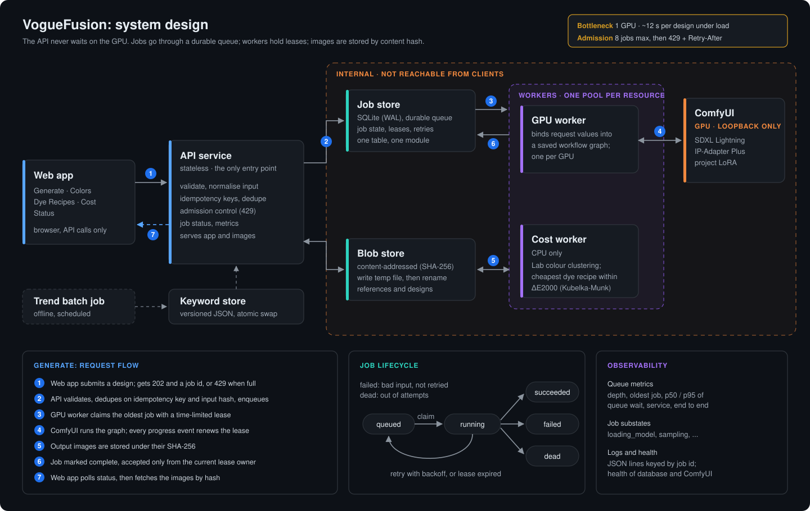
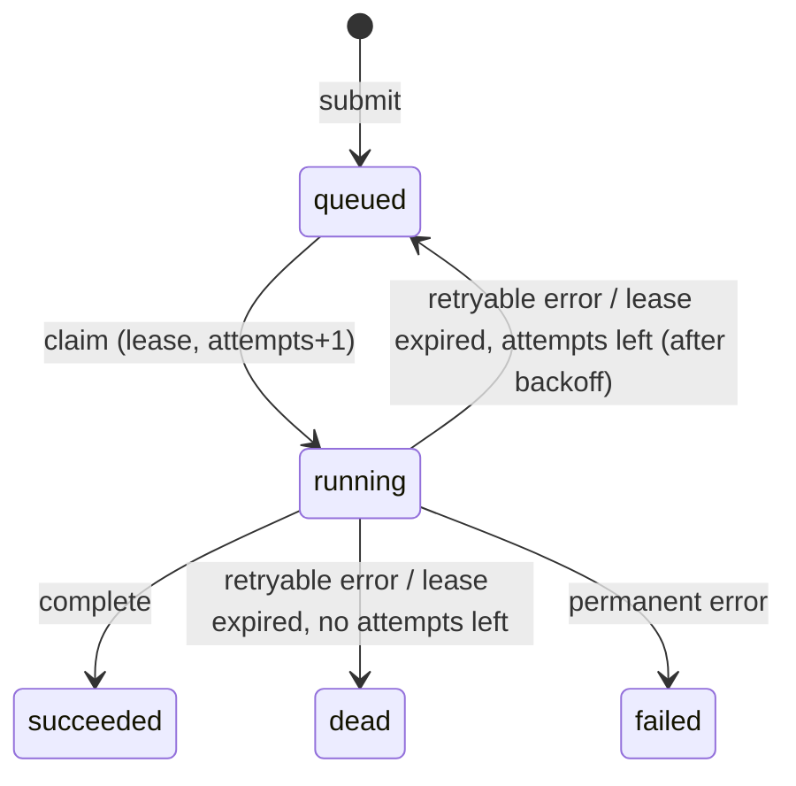

# Architecture

This is the system as built and measured. Decisions and their rejected
alternatives are in [`DECISIONS.md`](DECISIONS.md) (ADR-n below). Every
number here was measured on this machine on 2026-11-10/11 unless it is
listed under [Open measurements](#open-measurements).

Machine: NVIDIA RTX 3060 Laptop GPU (6,144 MiB, driver 595.99.02), 22 GB
RAM, of which the services may use 14 GB.

## 1. Requirements

**Functional**

1. Generate print designs from 1 to 4 reference images and a prompt, with
   or without the project's LoRA.
2. Quote the dye cost of printing any design image on a given fabric.
3. Offer prompt keywords from an offline keyword store.

**Non-functional**

| Requirement | How it is met |
|---|---|
| Accepted work is never lost | Durable job table, leases, retries (ADR-002, ADR-011) |
| Backlog is bounded and the client is told when to come back | Depth limit per job kind, 429 with computed `Retry-After` |
| The same request is not run twice on the GPU | Idempotency keys and input-key coalescing (ADR-014) |
| A quote is reproducible | Deterministic solver (ADR-008); result keyed by solver version, catalogue and config hashes |
| A generation is traceable | Seed, workflow hash, model hashes on every result (ADR-015) |
| User input cannot reach the GPU process unchecked | Validation at the API; ComfyUI on loopback only; graph values set by role, never templated |
| Fits one 6 GB GPU and a 14 GB RAM budget | One GPU worker; measured peaks below |

**Non-goals** (each is in [Scaling out](#8-scaling-out) with its trigger):
authentication, multiple tenants, more than one machine, high
availability, model training.

## 2. Components

| Component | Process | Resource | State it owns |
|---|---|---|---|
| API | `python -m voguefusion.api` (also serves the web app) | CPU | none (stateless) |
| Web app | static files in `ui/web/`, run in the browser | browser | the current design and quote, in page memory |
| GPU worker | `python -m voguefusion.worker generate` | drives the GPU through ComfyUI | none |
| Cost worker | `python -m voguefusion.worker cost` | CPU, about 0.35 s per colour | none |
| ComfyUI | `~/ComfyUI/main.py --listen 127.0.0.1` | GPU, 5.65 GB VRAM peak, 12.3 GB RSS peak | in-memory model and result caches |
| Job store | file `jobs.sqlite3` | disk | jobs, leases, results |
| Blob store | directory `blobs/` | disk | images |
| Keyword store | directory `trends/` | disk | keyword versions |

`scripts/vf.sh start|stop|status` manages all processes; logs are JSON
lines with `job_id`, in `$VOGUEFUSION_DATA/logs/`.

## 3. API and data model

| Method | Path | Notes |
|---|---|---|
| POST | `/v1/references` | multipart image; PNG, JPEG or WebP; 64 to 4,096 px per side; at most 10 MB; re-encoded to PNG; returns `sha256` |
| POST | `/v1/designs` | `{workflow, prompt, negative?, seed?, batch, references[1..4]}`; 202 + `Location` (new), 200 (existing job), 409 (idempotency key reused with another body), 422 (invalid), 429 + `Retry-After` |
| GET | `/v1/designs/{id}` | state, substate, attempts, result |
| POST | `/v1/costs` | `{artifact, gsm, length_m, width_m, substrate, n_colours}`; same status codes |
| GET | `/v1/costs/{id}` | quote: per colour target and predicted colour, ΔE, feasible, dyes with g/kg and cost |
| GET | `/v1/artifacts/{sha}` | `ETag` = hash, `Cache-Control: immutable`, 304 on match |
| GET | `/v1/workflows` | each workflow's default negative prompt, batch and reference slots, and the costing UI link |
| GET | `/v1/costing` | dye catalogue (name, swatch RGB, price per kg), fabric defaults, substrates, tolerance |
| GET | `/v1/suggestions`, `/v1/metrics`, `/healthz` | |
| GET | `/` | the web app (static HTML/CSS/JS, same origin as the API) |

**Job row** (`src/voguefusion/jobstore.py`): `id, kind, state, substate,
input_json, input_key, idempotency_key (unique), result_json, error,
attempts, max_attempts, lease_owner, lease_expires_at, available_at,
created_at, started_at, finished_at, updated_at`. Indexes support claim
(`kind, state, available_at, created_at`), coalescing (`kind, input_key,
state`) and metrics (`kind, state, finished_at`).

Retryable: ComfyUI unreachable or silent past `ws_idle_timeout_s`,
execution errors such as out-of-memory, any unexpected exception.
Permanent: ComfyUI rejecting the graph (validation), a workflow file or
solver version that changed since submit, no output images.

**Blob layout**: `blobs/<first two hex>/<sha256>`, written by temp file,
fsync, rename, directory fsync (ADR-003).

**Keyword store**: `trends/<version>.json` plus `current.json`, both
replaced atomically; `version` is a hash of the content (ADR-009).

## 4. Life of a request

Generate:

1. The web app uploads each reference to `POST /v1/references`. The API decodes
   the bytes, checks format and size, re-encodes to PNG and stores the blob
   under its hash.
2. The web app posts `/v1/designs` with an `Idempotency-Key`. The API checks the
   references exist, fills in the seed (random, or derived from the key),
   reads the workflow file to get its hash, and computes the input key.
3. In one `BEGIN IMMEDIATE` transaction the job store returns the existing
   job for this idempotency key or input key, or rejects with 429 if the
   generate queue is at `max_depth`, or inserts a `queued` row. The API
   returns 202 and `Location: /v1/designs/{id}`.
4. The GPU worker polls every 0.5 s. `claim()` first returns jobs with
   expired leases to the queue, then takes the oldest available job,
   setting `running`, a lease of 300 s and `attempts + 1`.
5. The worker uploads the references to ComfyUI's input folder as
   `vf_<sha>.png`, binds prompt, negative, seed, batch and reference names
   into the graph, opens the websocket and queues the graph.
6. Each executing-node message maps to a substate (`loading_model`,
   `encoding_references`, `sampling`, ...) and renews the lease; the worker
   also renews every 10 s while waiting. If the lease cannot be renewed
   (another worker owns the job now) it stops without writing.
7. On completion the worker downloads the outputs, stores each as a blob,
   and calls `complete()`, which only succeeds if this worker still owns
   this attempt.
8. The web app polls `GET /v1/designs/{id}` every second, then loads the images
   from `/v1/artifacts/{sha}`.

Cost: the web app (from a Generate result, or an uploaded image) posts `/v1/costs` with an artifact hash. The cost worker reads
the image, clusters its pixels in Lab into up to 5 colours, solves each
colour (ADR-007, ADR-008), and stores the quote. Its input key includes the
solver version and the hashes of the catalogue and costing config, so a
repeated quote is served from the stored result until one of those changes.

## 5. Failure modes

| Failure | Behaviour | Test |
|---|---|---|
| Worker killed mid-job | Lease lapses; next claim requeues it after backoff; another worker completes it as attempt 2 | `tests/services/test_api_and_workers.py::test_worker_killed_mid_job_recovers` (real SIGKILL) |
| Worker paused past its lease, then resumes | Its renew/complete/fail writes are refused (fencing); the new owner's result stands | `tests/services/test_stores.py::test_stale_worker_cannot_complete_after_losing_its_lease` |
| ComfyUI down | Retried with backoff, then `dead` with the last error | `::test_comfy_unreachable_retries_then_dead` |
| ComfyUI hangs | No websocket message for `ws_idle_timeout_s` (240 s): attempt fails and is retried | `::test_hung_comfy_times_out_and_retries` |
| Out of memory on the GPU | Execution error is retryable; repeated failure ends `dead` | `::test_execution_error_is_retried` |
| Graph rejected by ComfyUI | `failed` immediately, no retry | `::test_rejected_graph_fails_without_retry` |
| Queue full | 429 with `Retry-After`; nothing is enqueued | `::test_backpressure_returns_429_with_retry_after` |
| Client retries a submit | Same job returned; different body under the same key is 409 | `::test_design_submit_dedupe_and_idempotency` |
| Crash during a blob write | No file at the final address; temp file removed | `test_stores.py::test_interrupted_blob_write_leaves_nothing_at_final_address` |
| Blob corrupted on disk | Workers read with hash verification and fail the attempt | `test_stores.py::test_corrupt_blob_detected_on_verified_read` |
| Stuck GPU job while quotes arrive | Quotes are served by their own worker | `::test_cost_is_not_blocked_by_a_stuck_gpu_job` |
| API restart | No state in the API; jobs and blobs are on disk | `test_stores.py::test_jobs_survive_reopening_the_database` |
| Hostile prompt text | Written as a string value; graph structure unchanged | `test_workflow.py::test_hostile_prompt_text_cannot_change_graph_structure` |
| Malformed or oversized upload | 415, 413 or 422; trailing bytes dropped by re-encoding | `::test_upload_rejects_non_images_and_bad_sizes`, `::test_upload_size_limit`, `::test_upload_is_normalised_so_trailing_bytes_are_dropped` |

Known gaps: a worker crash between writing output blobs and calling
`complete()` leaves blobs no job points to (harmless, never garbage
collected). A GPU job whose lease expires while its worker is still alive
(for example a model load longer than 300 s with no websocket traffic) can
run twice; the outputs are identical because the seed is fixed, so the
effect is wasted GPU time, not wrong results. Execution is at least once;
effects are idempotent.

## 6. Capacity

### Single job (`scripts/measure.py profile`)

Raw results: `$VOGUEFUSION_DATA/measurements/profile-20261110T195226Z.json`.
Each run uses a fresh seed so ComfyUI's in-memory result cache never
short-cuts it. ComfyUI was restarted first for the cold run; the
checkpoint was still in the OS page cache (OM-7).

| Run | Service time (s) | Notes |
|---|---|---|
| v1, first after ComfyUI start | 40.8 | ComfyUI process start to HTTP ready: 10.6 s, not included |
| v1, warm (3 runs) | 10.1 to 10.4 | sampling 8.5 to 8.7 s, i.e. 0.86 s per step for 10 LCM steps |
| v2, first (LoRA load) | 19.0 | |
| v2, warm (2 runs) | 12.1, 12.5 | |
| v1 straight after v2 | 15.0 | switching the model costs about 5 s, mostly re-encoding references |
| v1, batch 3 | 26.9 | 9.0 s per image, 12% cheaper than 3 single jobs |
| v2, batch 3 | 36.4 | no gain over 3 single jobs on this GPU |
| Cost, 5 colours (3 runs) | 2.8 to 3.1 | 2.4 s solving, 0.5 s extracting colours |

Peaks during the profile: GPU memory 5,650 of 6,144 MiB; ComfyUI resident
memory 12,315 MiB. ComfyUI alone uses most of the 14 GB RAM budget, so one
ComfyUI process per machine of this size is a hard limit.

Queue wait includes up to one worker poll interval (0.5 s) because workers
poll the table rather than being notified.

### Throughput

With warm models and a cool GPU, one GPU completes about 1/10.2 s ≈ 5.9 v1
designs per minute (4.9 for v2). Under sustained load the laptop GPU
throttles and service time settles near 12.5 s (4.8 per minute); see the
load test below. Service time is almost constant (variance over mean
squared below 0.01), so the generate queue behaves like M/D/1. Mean queue
wait under Poisson arrivals at utilisation ρ is then
`W_q = ρ · S / (2(1 − ρ))` (Pollaczek-Khinchine with zero service
variance): 5.1 s at ρ = 0.5, 20.4 s at ρ = 0.8, 97 s at ρ = 0.95.

`max_depth` 8 caps that. An admitted job waits at most 7 services
(7 × 12.5 ≈ 88 s for sustained v1, 7 × 36.4 ≈ 4.2 minutes for v2 batch 3)
before it starts. 429 responses begin once the system holds 8 jobs; with M/D/1
that becomes common only as ρ approaches 1.

### Load test (`scripts/measure.py load`)

Raw results: `$VOGUEFUSION_DATA/measurements/load-20261110T195650Z.json`.
Open-loop Poisson arrivals of v1 batch-1 jobs, 20 per run, each with a
fresh seed; arrival rates set from a 10.2 s service time; clients that get
429 do not retry.

| Target ρ | λ (jobs/s) | Mean service (s) | Measured ρ = λ·S | 429s | Wait mean / p50 / p95 (s) | End to end p50 / p95 (s) | M/D/1 mean wait (s) |
|---|---|---|---|---|---|---|---|
| 0.50 | 0.049 | 10.2 | 0.50 | 0 of 20 | 1.0 / 0.4 / 4.0 | 10.2 / 14.4 | 5.1 |
| 0.80 | 0.078 | 10.4 | 0.82 | 0 of 20 | 4.1 / 1.1 / 12.7 | 11.6 / 24.1 | 23.5 |
| 0.95 | 0.093 | 13.4 | 1.25 | 0 of 20 | 32.5 / 29.2 / 58.9 | 43.3 / 71.6 | unstable |
| 1.30 | 0.128 | 13.2 | 1.68 | 2 of 20 | 41.7 / 36.4 / 88.9 | 50.8 / 102.8 | unstable |

Reading it:

- At ρ 0.5 and 0.8 the measured mean wait is well below the M/D/1
  prediction. A 20-job run that starts from an empty queue is a transient,
  not a steady state; the formula describes the long-run average. These
  rows support "waits are small at moderate load", not the model.
- From the third run on, service time rose from 10.2 to about 13.3 s, so
  the real utilisation was above 1 and the queue grew for the whole run.
  The cause is thermal throttling of the laptop GPU, measured separately
  (`$VOGUEFUSION_DATA/measurements/thermal_*`): eight back-to-back jobs took
  10.7, 10.8, 11.2, 12.5, 12.7, 12.6, 12.4 and 12.6 s while the SM clock
  fell from about 1,360 to 1,100 MHz, power from 60 to 48 W, at 86 to 88 °C,
  with the driver reporting thermal slowdown (reason `0x20`).
- 429s appeared only in the overloaded runs, and only 2 of 20 at ρ 1.68,
  because 20 arrivals are too few to keep 8 jobs in the system for long.
  The p95 wait at ρ 1.68 (89 s) is close to the analytical bound for an
  admitted job (7 waiting services × 13 s ≈ 91 s).
- Capacity planning on this machine must use the sustained service time
  (about 12.5 s, 4.8 designs a minute), not the cool-GPU 10.2 s. The
  `Retry-After` value already follows it, because it uses the measured p50
  service time of recent jobs.

### Costing

One cost worker handles about 20 quotes per minute. Costing is CPU-only, so
more cost workers can be added freely up to the core count; it is never the
bottleneck next to the GPU.

## 7. Security

- ComfyUI has no authentication and accepts arbitrary graphs, so it listens
  on 127.0.0.1 only and only the GPU worker talks to it.
- Clients cannot send a graph. They send values; the worker writes each one
  into a known node input of a saved graph.
- Uploads are decoded with a pixel limit (decompression bombs), checked for
  format and size, and re-encoded, so the stored and forwarded bytes are
  pixels only.
- Blob names must be 64 hex characters, so a path cannot escape the store.
- All services bind to 127.0.0.1. There is no authentication; putting this
  on a network needs a gateway with auth and per-client rate limits first.
- Every process except ComfyUI runs with `CUDA_VISIBLE_DEVICES=` so nothing
  else can allocate GPU memory.

## 8. Scaling out

What changes, and the measurement that should trigger it.

**10x load (about 60 designs a minute).** About ten GPUs.

- Queue: SQLite becomes Postgres with `SELECT ... FOR UPDATE SKIP LOCKED`
  in `claim()`; only `jobstore.py` changes. Trigger: a second machine.
- Blobs: an object store with the same `<aa>/<sha256>` keys; artifacts
  served through a CDN, which the immutable cache headers already allow.
- GPU workers: one worker plus one ComfyUI per GPU (one ComfyUI per GPU is
  forced by the 5.65 GB VRAM and 12.3 GB RAM it uses).
- Routing by model: switching between v1 and v2 costs about 5 s and the
  first LoRA load about 7 s against a 10 to 12 s job, so jobs should go to
  workers that already have their model loaded. Trigger: model-switch time
  above roughly 20% of GPU time.
- API: several stateless instances behind a load balancer, with auth and
  per-client rate limits at the gateway.
- Workers get notified (Postgres `LISTEN/NOTIFY`) instead of polling, which
  removes the 0.5 s poll from queue wait.
- Metrics move from `/v1/metrics` to Prometheus.

**100x load.**

- Autoscale the GPU pool on queue depth and oldest-job age; scale to zero
  off-peak since GPU hours dominate cost.
- Priority classes (interactive vs bulk) as separate queues with their own
  depth limits.
- Webhooks for server-to-server clients instead of polling.
- Blob garbage collection by reachability from job results, with a
  retention policy.
- Isolation between tenants: separate ComfyUI processes per tenant, or move
  generation to a `diffusers` pipeline (ADR-001 revisit).
- Batching gives 12% on v1 and nothing on v2 on this GPU; re-measure on the
  target GPU before relying on it.

## 9. Observability

- Job status carries a substate, so `loading_model` (cold start) is
  distinguishable from `sampling` and from a stuck job.
- `GET /v1/metrics` per kind: counts by state, depth, oldest queued age,
  p50/p95/max of queue wait, service time and end-to-end latency over the
  last 200 successful jobs, all derived from timestamps on the job rows.
- JSON-lines logs with `job_id`, attempt and worker id.
- `GET /healthz` checks the database and whether ComfyUI answers.

## 10. Questions an interviewer is likely to ask

**Why a queue at all?** One generation fills 5.65 of 6.14 GB of VRAM and
takes 10 to 40 s; a second concurrent one cannot run, and an HTTP request
held for 40 s does not survive retries. Section 6; ADR-002.

**What happens if a worker dies mid-job?** The lease stops being renewed;
the next claim after expiry requeues the job, and another worker finishes
it as attempt 2. Tested with a real SIGKILL
(`test_worker_killed_mid_job_recovers`).

**Can a slow worker that lost its lease overwrite the new result?** No.
Every worker write is conditional on `lease_owner` and `attempts`; the
stale worker's update matches zero rows
(`test_stale_worker_cannot_complete_after_losing_its_lease`).

**Is it exactly once?** Execution is at least once; a job can run twice if
a lease expires while the worker is alive. Effects are idempotent: the
seed is fixed, outputs are content-addressed, and only the current lease
holder can complete. Section 5.

**Why SQLite and not Redis or Kafka?** One machine, one GPU, a few jobs a
minute. SQLite in WAL mode gives durable, atomic, inspectable state with no
extra process. All queue SQL is in one module, and the Postgres
replacement is `SKIP LOCKED` in `claim()`. ADR-011.

**How do you handle overload?** A depth limit per job kind. Beyond it,
submit returns 429 with `Retry-After = ceil(depth × p50 service / workers)`,
using measured service time. The limit of 8 caps the worst admitted wait
at about 88 s for sustained v1; the load test's p95 wait under overload
was 89 s. Section 6.

**How do retries avoid making things worse?** Errors are classified:
validation failures are permanent; transient ones are retried with backoff
growing linearly in the attempt number, up to 3 attempts, then `dead` with
the last error kept.

**What if the client retries the submit?** With an `Idempotency-Key` it
gets the same job; reusing the key with a different body is 409. Even
without a key, an identical request (same seed) is coalesced with the
in-flight or finished job and never reaches the GPU again
(`test_cached_result_does_not_touch_the_gpu`). ADR-014.

**What is the bottleneck?** The GPU: 10.2 s per warm v1 design on a cool
GPU, about 12.5 s once the laptop GPU throttles under sustained load (4.8
per minute). Costing takes 3 s on CPU. Section 6.

**How would you scale it 10x? 100x?** Section 8: Postgres queue, object
store, one ComfyUI per GPU, model-affinity routing (measured 5 to 7 s
switch cost), autoscaling on queue depth.

**How do you know the dye quote is right?** The solver is tested against a
brute-force grid, against published CIEDE2000 test data, and for
determinism. The absolute rupee figure is not reliable, because the
catalogue's dye colours are placeholders and the reference depth is an
assumption (OM-1). ADR-005.

**Why not the genetic algorithm?** Measured: the same colour's quote varied
by 3x to 42x across seeds on the real catalogue. With 20 dyes and at most 3
per recipe there are only 1,350 dye sets, so exhaustive search with a
closed-form screen is faster and deterministic. ADR-008.

**How do you stop prompt injection into ComfyUI?** Clients never send a
graph. Values are written into known node inputs of a saved graph, and
ComfyUI is only on loopback (`test_hostile_prompt_text_cannot_change_graph_structure`).

**How is the trend feature validated?** It cannot be yet: the original
scrape was never analysed and its images are gone. The pipeline is built
and tested in closed form; the store says honestly that it holds domain
keywords, not trends. ADR-009.

**What surprised you in the measurements?** The laptop GPU throttling
under sustained load (service time up 20%, which turned a planned ρ of 0.95
into a real 1.25); ComfyUI's 12.3 GB resident memory; batching helping only
12%; and ComfyUI caching identical graphs, which would have made a naive
benchmark look 100x faster.

## Open measurements

Assumptions the system currently runs on, and what would replace them.

- **OM-1** Dye swatch colours and the depth they represent. ASSUMED: 20 g
  of dye per kg of fabric for unit concentration, swatch reflectance clamped
  to [0.03, 0.95] (`configs/voguefusion.yaml`, `costing`). Replace with
  swatches measured at a known depth.
- **OM-2** Per-dye spectral reflectance curves (400 to 700 nm) from the
  supplier, needed for spectral Kubelka-Munk (ADR-005).
- **OM-3** Cotton substrate reflectance. ASSUMED: sRGB (0.92, 0.89, 0.82).
  Measure the actual fabric.
- **OM-4** The ΔE tolerance (2.0) and CIEDE2000 weights against real QC
  pass/fail data (ADR-004).
- **OM-5** Real demand: arrival rate and burstiness, to set `max_depth`
  and the number of GPUs. The load test uses synthetic Poisson arrivals.
- **OM-6** Saree width. ASSUMED: 1.1 m (44 inch loom width); length 5.5 m.
- **OM-7** Cold start from disk with an empty OS page cache (needs root to
  drop caches); the measured 40.8 s had the checkpoint already in memory.
